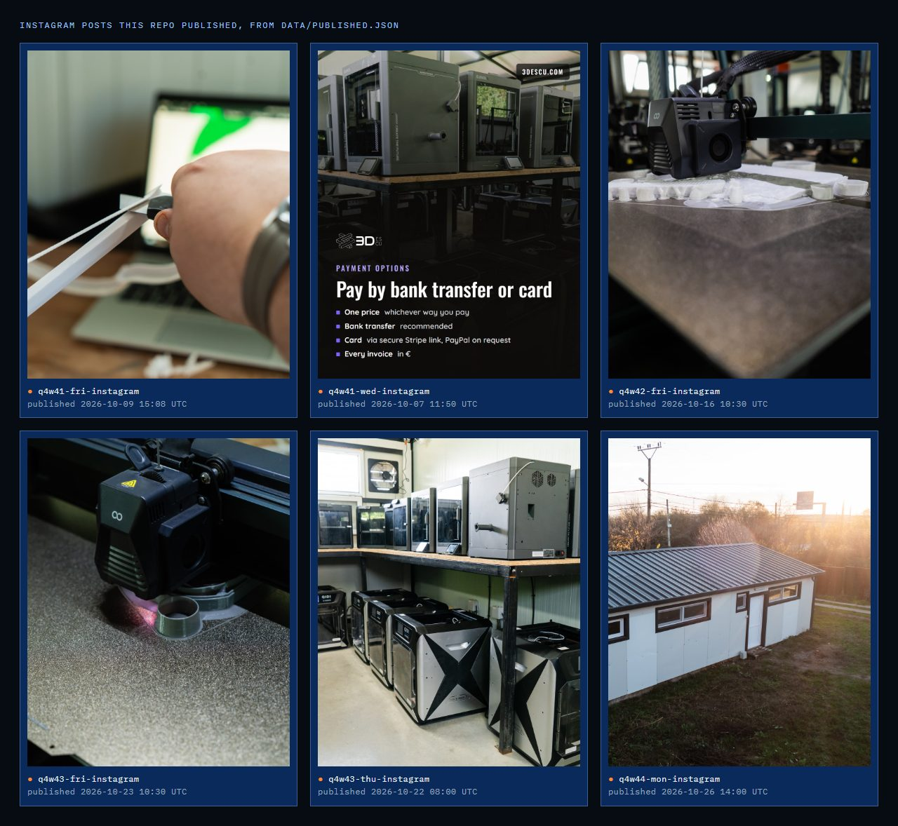
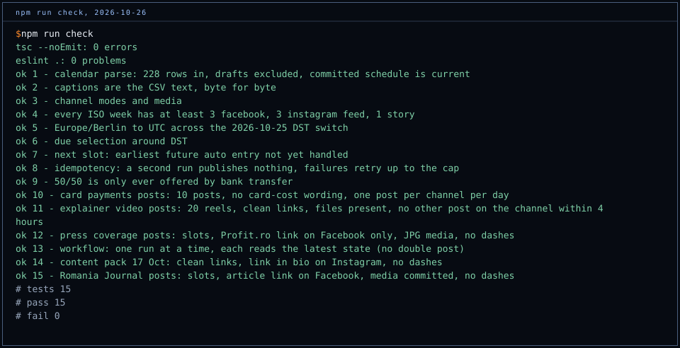

# 3Descu calendar publisher

[](https://github.com/cadi27tech/3descu-social-agent/actions/workflows/check.yml)
[](https://github.com/cadi27tech/3descu-social-agent/actions/workflows/publish.yml)

Publishes a pre-written quarterly social calendar to the 3Descu Facebook Page and Instagram Business account, on time, from GitHub Actions. No content is generated: every caption, image and video goes out exactly as written. Cost: EUR 0 a month (Actions minutes are free on a public repo, the Meta Graph API is free, and the media is served from this repo).

The quarter is written once, reviewed as a pull request, and then goes out on its own: no running cost, no one at a keyboard on posting days, and a commit for every post.

<picture>
  <source media="(max-width: 600px)" srcset="docs/architecture-m.svg">
  
</picture>

## The Q4 2026 calendar, from `data/schedule.json`

| | Entries | Channels |
|---|---|---|
| Automated by this repo | 163 | Facebook 75, Instagram feed 74, Instagram Stories 14 |
| Kept in the schedule, posted elsewhere | 61 | LinkedIn 44, Google Business Profile 12, YouTube 5 |
| **Total** | **224** | from 228 CSV rows, drafts dropped |

Automated posts run from 1 Oct to 30 Dec 2026: single images, carousels, Reels and Stories, with 15 videos and 105 images in `media/`. What has already gone out, with the Meta post ids, is in [data/published.json](data/published.json), which every run commits back. The workflow has run more than 200 times.



## How it works

| Piece | Where |
|---|---|
| Calendar source (Metricool 94-column CSV) | [data/calendar-q4-2026.csv](data/calendar-q4-2026.csv) |
| Normalised schedule (224 entries, drafts dropped) | [data/schedule.json](data/schedule.json), built by [scripts/build-schedule.ts](scripts/build-schedule.ts) |
| Publish state (what is already posted) | [data/published.json](data/published.json), committed back by the workflow |
| Media | [media/](media/), served at `https://raw.githubusercontent.com/cadi27tech/3descu-social-agent/main/media/<path>` |
| Publisher | [src/main.ts](src/main.ts), [src/core.ts](src/core.ts), [src/meta.ts](src/meta.ts), [src/next.ts](src/next.ts) |
| Cron and hand-over | [.github/workflows/publish.yml](.github/workflows/publish.yml) |

- **Automated channels:** `facebook` (image, multi-photo, Reel), `instagram` (image, carousel, Reel), `story` (Instagram Story, image or video).
- **Manual channels:** `linkedin`, `youtube` and `gbp` stay in the schedule with `"mode": "manual"`. They are scheduled natively elsewhere; this bot never touches them.
- **Times:** the calendar is in Europe/Berlin wall-clock time; `publish_at` is UTC and already accounts for the 25 Oct 2026 DST switch.
- **Due rule:** an entry is posted on the first run after `publish_at`. If it is more than 24 hours overdue it is recorded as `missed` and never posted late, so switching the bot on mid-quarter does not dump a backlog.
- **Idempotent:** every success is written to `data/published.json` straight away and committed even when another post in the same run failed. A recorded id is never posted again. A failed post is retried on the next runs, at most 3 attempts.
- **On time:** GitHub fires the 15-minute cron only a few times a day, hours apart. So after publishing, each run waits for the next slot (up to 12 hours ahead, in hops of at most 5.5 hours) and starts a fresh run at that minute with the repo token. The cron is the fallback that restarts the chain.
- **Failure alerts:** a failed or missed post fails the run, and GitHub emails the repo owner. No personal data in logs.
- **Dry run:** if any of the three secrets is missing, or the workflow is started with `dry_run`, it only logs what is due and exits 0. With secrets present, a dry run also checks them read-only.

## What went wrong, and what changed

- **The cron is not a clock.** In September and October 2026 GitHub fired the 15-minute schedule about five times a day, hours apart, so half-hour slots went out late. Fix (13 Oct): the hand-over step above. Each run sleeps until the next slot and starts its successor; the cron only restarts the chain.
- **A Story went out twice (14 Oct, 11:00).** A run queued behind another checked out the commit that triggered it, not the branch tip, so it never saw the state the first run had pushed. Fix: check out `github.ref_name` at start, one run at a time (`concurrency`), and a test that pins both.
- **Missed is missed.** The first miss window was too tight for a cron that fires hours apart. It is now 24 hours, and anything older is recorded as missed rather than posted late, out of context.

## Checks



`npm run check` runs the typecheck, the linter and 15 tests: the CSV round-trips byte for byte into the schedule, captions are never edited, Berlin to UTC across the DST switch, due selection, the next-slot maths, idempotency and the retry cap, the one-run-at-a-time workflow, and per-campaign rules (clean links, no dashes, media files present). CI runs it on every push and pull request.

## Setup (about 20 minutes)

1. **Meta app.** developers.facebook.com, My Apps, Create app: use case Other, type Business, attached to the business portfolio. Fill the privacy policy URL and category, then switch App Mode to **Live** (posts by an app in Development mode are visible only to people with a role on the app).
2. **System user.** Business settings, Users, System users, Add: role Admin. Assign assets with full control: the Page, the Instagram account and the app.
3. **Token.** Generate a token for the app with expiration **Never** and exactly these permissions: `pages_manage_posts`, `pages_read_engagement`, `instagram_basic`, `instagram_content_publish`, `business_management`, `pages_show_list` (read-only; lets the bot swap the system user token for the Page token).
4. **IDs.** The Page ID is under the Page name in Business settings. The Instagram user ID comes from:

   ```bash
   curl -s -H "Authorization: Bearer PASTE_TOKEN" "https://graph.facebook.com/v24.0/PASTE_PAGE_ID?fields=instagram_business_account"
   ```

5. **GitHub secrets.** Settings, Secrets and variables, Actions: `META_PAGE_ID`, `META_IG_USER_ID`, `META_SYSTEM_USER_TOKEN`. Then Actions, Publish social calendar, Run workflow with `dry_run` ticked. The log must end with `Credentials OK`.

## Media hosting

The repo is public, so media is committed under `media/` and Meta fetches it from `raw.githubusercontent.com`. Images are served as `image/jpeg`; videos as `application/octet-stream`, which Meta accepts. If a Reel ever fails with a media fetch error, switch the host without touching code: enable GitHub Pages on `main` and set the repository variable `MEDIA_BASE_URL` to `https://cadi27tech.github.io/3descu-social-agent/media`. Every URL is checked with a HEAD request before posting, so a broken link fails loudly instead of posting without media.

## Changing the calendar

1. Replace [data/calendar-q4-2026.csv](data/calendar-q4-2026.csv) with the new export.
2. `npm run build:schedule` (or `npm run build:media` to also copy new media in).
3. `npm run check`, then open a pull request. Captions are copied byte for byte; the tests fail if `data/schedule.json` does not match the CSV.

## Local commands

```bash
npm ci && npm run check
npm run publish:dry
```

Node 22.18+ runs the TypeScript directly (type stripping); there is no build step.

## Kill switch

Actions, Publish social calendar, Disable workflow. To skip a single post, add its id to `data/published.json` with `"status": "missed"`.

## Licence

Code (`src/`, `scripts/`, `test/`, workflows): MIT, see [LICENSE](LICENSE). Captions and media are 3Descu's and are not licensed for reuse.

Built by [Adrian Capraru](https://github.com/cadi27tech), founder of 3Descu.
